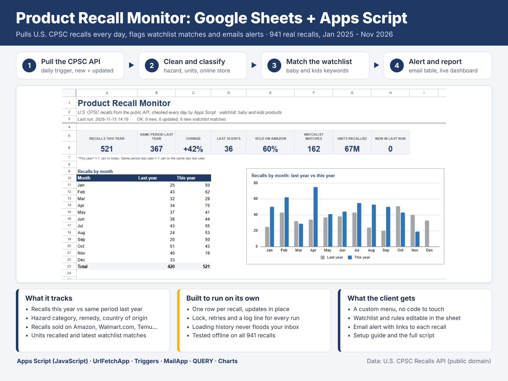
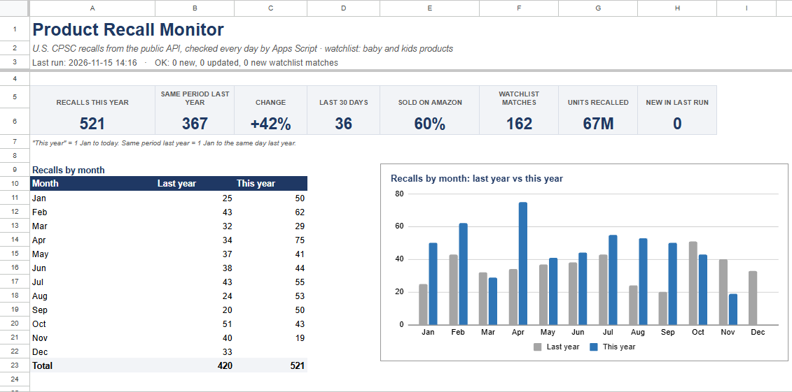
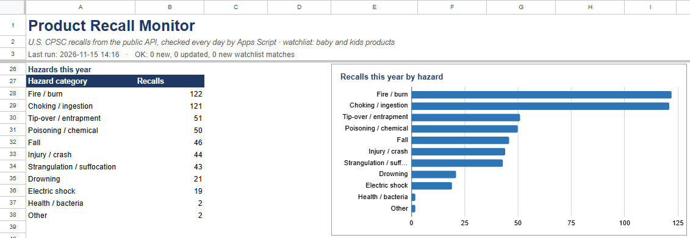
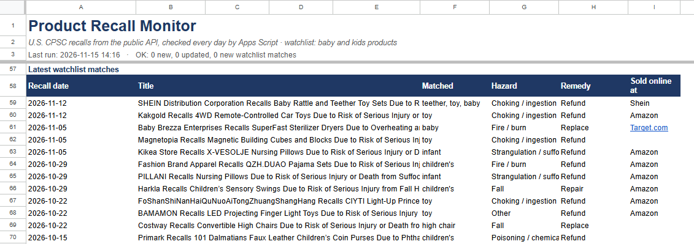
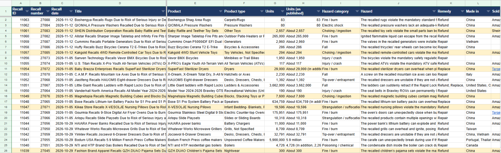
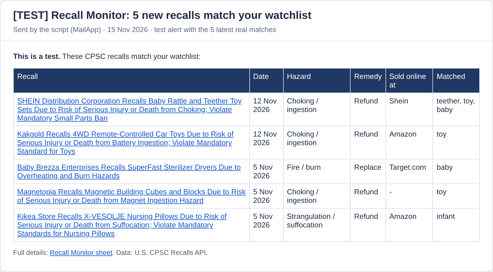
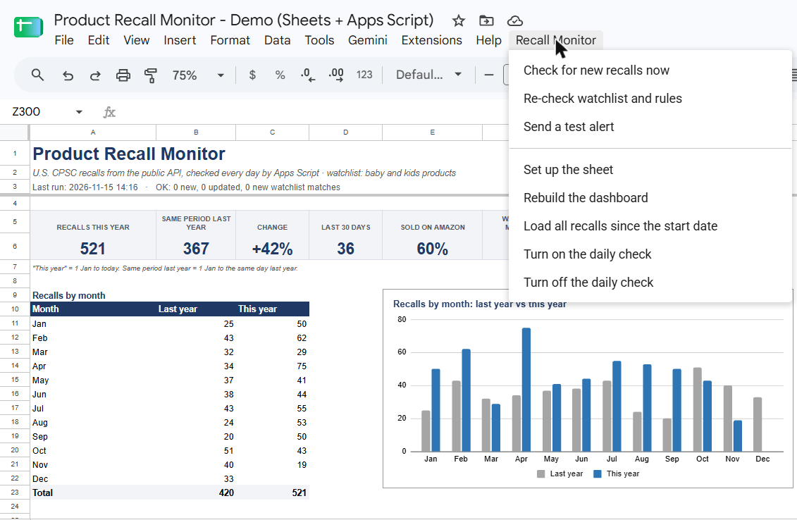
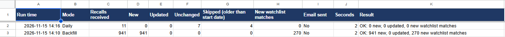

# Product Recall Monitor (Google Sheets + Apps Script)



A Google Sheet that checks U.S. Consumer Product Safety Commission (CPSC) recalls every morning, keeps one clean row per recall, flags the recalls that match a watchlist (here: baby and kids products) and emails the new matches. It runs entirely inside Google Sheets with Apps Script (JavaScript): no server, no paid tools, no add-ons.

Who it is for: an online seller, importer or compliance team that needs to know quickly when a product like theirs is recalled, why, and which marketplaces sold it.

## What it does

- **Pulls the data every day.** A time-driven trigger calls the public CPSC Recalls API and asks for every recall published or updated since the last run (plus a few days of overlap, so late edits are not missed).
- **One row per recall.** Records are merged by Recall ID. An updated recall is rewritten in place and keeps its "First seen" date; an unchanged one is skipped.
- **Cleans and classifies.** Hazard category (10 editable rules), units as a number ("About 265,000" becomes 265000), remedy, country of origin, and the online stores named in the recall (Amazon, Walmart.com, Temu, Shein, TikTok Shop, eBay, Etsy, AliExpress, Wayfair, Target.com).
- **Matches a watchlist.** Whole-word keywords in the title, product name and product type: "toy" matches "Toys" but not "Toyota", "crib" does not match "Cribbage". Matches are highlighted in the Recalls tab.
- **Sends an alert.** An HTML email lists the new matches with a link to each CPSC page. Loading history never sends an email, and one email shows at most 25 rows.
- **Reports.** A dashboard built only with formulas and charts: this year vs the same period last year, last 30 days, share sold on Amazon, units recalled, hazards, online stores, country of origin, remedy and the latest matches.
- **Logs every run.** Received, new, updated, unchanged, skipped, new matches, email sent and run time.

## Results with real data

Loaded on 15 Nov 2026: 941 recalls dated 1 Jan 2025 to 12 Nov 2026.

| Measure | Value |
|---|---|
| Recalls in 2026, 1 Jan to 15 Nov | 521 |
| Same period of 2025 | 367 (+42%) |
| Recalls in the last 30 days | 36 |
| 2026 recalls that name Amazon as a seller | 310 (60%) |
| 2026 recalls that match the baby and kids watchlist | 162 |
| Units recalled in 2026 | about 67 million |

- Top hazards in 2026: fire or burn 122, choking or ingestion 121, tip-over or entrapment 51, poisoning or chemical 50, fall 46.
- Made in China: 405 of the 521 recalls of 2026.
- Remedy: refund in 373 recalls, repair in 96, replacement in 76.
- Online stores named besides Amazon: Walmart.com 48, Target.com 20, Wayfair 15, Temu 10, Shein 7, eBay 6, TikTok Shop 5, Etsy 5, AliExpress 1.

## Screenshots

Dashboard: KPIs and recalls by month, this year vs last year.



Hazards this year.



Latest watchlist matches.



Recalls tab: one row per recall, watchlist matches in amber.



Alert email (a test send with the 5 latest real matches).



Custom menu.



Log tab.



## Set it up in 5 minutes

1. Create a blank Google Sheet.
2. Open **Extensions > Apps Script**, replace the sample code with [Code.gs](Code.gs) and save.
3. Reload the sheet. A **Recall Monitor** menu appears.
4. Click **Recall Monitor > Set up the sheet** and approve the permissions (Google asks once).
5. Click **Recall Monitor > Load all recalls since the start date** (about 1,000 rows, a few seconds).
6. Click **Recall Monitor > Turn on the daily check**. To get emails, set **Send email alerts** to Yes in the Settings tab (blank email = the sheet owner).

## Menu

| Menu item | What it does |
|---|---|
| Check for new recalls now | Runs the daily check right away |
| Re-check watchlist and rules | Applies the current watchlist, hazard rules and store rules to every row, without calling the API |
| Send a test alert | Emails the 5 latest matches, marked as a test |
| Set up the sheet | Creates any missing tab |
| Rebuild the dashboard | Rewrites the dashboard formulas and charts |
| Load all recalls since the start date | Loads history from the "Keep recalls dated from" setting; never emails |
| Turn on the daily check / Turn off the daily check | Adds or removes the daily trigger at the hour set in Settings |

## Tabs

| Tab | Content |
|---|---|
| Dashboard | KPI cards, monthly table and chart, hazards, online stores, country of origin, remedy, latest matches |
| Recalls | One row per recall, 21 columns, with a link to the CPSC page |
| Watchlist | Keyword, area, active (Yes or No) |
| Rules | Hazard categories (first match wins) and online stores, as patterns you can edit |
| Settings | Start date, alert email, alerts on or off, run hour, days to look back |
| Log | One line per run |
| How to use | The setup steps, inside the sheet |

## How the code works

- `fetchRecalls_()` calls the API with UrlFetchApp and tries up to 3 times, waiting longer each time.
- `dailySync()` asks for recalls by last publish date, from the last run minus the look-back days; `backfill()` asks by recall date, from the start date.
- `syncRecalls_()` runs under a script lock, merges by Recall ID, skips records whose publish date has not changed, keeps "First seen", sorts newest first, writes the whole table in one call, logs the run and sends the alert.
- `toRow_()` turns one API record into a row using `parseUnits_()`, `classifyHazard_()`, `detectMarketplaces_()` and `matchWatchlist_()`.
- `sendAlert_()` builds the HTML email and sends it with MailApp.
- `@OnlyCurrentDoc` keeps permissions small: the script can only open the sheet it lives in.

## Test it without a Google account

[test/test_code.js](test/test_code.js) runs Code.gs in Node.js with real API answers and a small fake of the Apps Script services. It checks unit parsing, whole-word matching, a full load (941 new, 270 matches, no email), a repeat run (nothing new), late updates, a new match (one email) and an updated recall ("First seen" kept). The file header has the 3 download links.

```
node test/test_code.js Code.gs recalls_2025.json recalls_2026.json lastpub.json
```

## Sample data

[sample-data/cpsc_recalls_2025_2026.csv](sample-data/cpsc_recalls_2025_2026.csv) holds the 941 rows of the Recalls tab (first 19 columns), so you can see the output without running anything.

## Notes and limits

- Hazard categories and online stores come from keyword rules on the published text, so a few recalls land in "Other" or miss a store. The rules live in the Rules tab and can be tuned without touching the code.
- Units use the first number in the published text (U.S. units; an extra count for Canada in brackets is ignored).
- "Sold online at" lists the marketplaces named in the text, not every store that sold the product.
- Apps Script daily quotas (URL fetches, emails) are far above what one run a day needs.

## Data source

U.S. Consumer Product Safety Commission, [Recalls API](https://www.cpsc.gov/Recalls/CPSC-Recalls-Application-Program-Interface-API-Information): `https://www.saferproducts.gov/RestWebServices/Recall?format=json`. U.S. government data, public domain. This project is not affiliated with or endorsed by the CPSC.

## Files

| File | What it is |
|---|---|
| Code.gs | The whole script (about 860 lines) |
| test/test_code.js | Offline test in Node.js |
| sample-data/cpsc_recalls_2025_2026.csv | Export of the Recalls tab |
| images/ | Screenshots and cover |
